##  {background-image="images/banner_geotec.jpeg" background-opacity=".15" background-size="cover"}

<br/>
<br/>

<div style="text-align:center;">
<h1 style="color:#1a3a5c; font-size:44pt; line-height:1.15; margin-bottom:10px;">Padrões Espaciais das Denúncias do Disque 100 no Nordeste Brasileiro em 2024</h1>
<!-- <h3 style="color:#2980b9; font-size:22pt; font-weight:500;">Uma Abordagem Integrada via Estatística Espacial e Geotecnologias</h3> -->
</div>

<br/>
<br/>
<br/>

<div style="text-align:center;">
<h4 style="color:#1a3a5c; font-size:20pt; margin-bottom:4px;"><strong>Prof. Dr. Jodavid de Araújo Ferreira</strong></h4>
<p style="color:#555; font-size:16pt; margin:0;">Departamento de Estatística — Universidade Federal de Pernambuco (UFPE)</p>
<p style="color:#7f8c8d; font-size:14pt; margin-top:4px;">📧 <a href="mailto:jodavid.ferreira@ufpe.br">jodavid.ferreira@ufpe.br</a> | 🌐 <a href="https://jodavid.github.io" target="_blank">jodavid.github.io</a></p>
</div>

<br/>

<div style="text-align:center;">
<h4 style="color:#1a3a5c; font-size:18pt; margin-bottom:4px;"><strong>Ana Vitória R. Araújo | Martha Liliana H. Madrid</strong></h4>
<p style="color:#555; font-size:16pt; margin:0;">Departamento de Estatística — Universidade Federal de Pernambuco (UFPE)</p>
</div>

<br/>

<div style="text-align:center; color:#1a3a5c; font-size:16pt; font-weight:bold; margin-top: 15px;">
II GEOTEC — Encontro de Geotecnologias | IFPB Campus João Pessoa — Novembro de 2026
</div>

---

##
<h2 style="color:#1a3a5c;">Trajetória da Pesquisa</h2>
<h4>e Contexto Acadêmico</h4>
<hr style="border-color:#2980b9;"/>

:::: {.columns}

::: {.column width="55%"}

- Esta conferência consolida os resultados da pesquisa sobre a **dinâmica geoespacial das violações de direitos humanos** no Nordeste do Brasil (ano de 2024).

- **Histórico e Maturação Científica do Trabalho:**
  - **III WDCD** (*III Workshop de Divulgação Científica e Didáticas*): Apresentação dos pilares conceituais de divulgação e democratização do dado público de violência.
  - **XIX EMR | V EPE** (*XIX Escola de Modelos de Regressão & V Encontro Paraibano de Estatística*): Discussão aprofundada dos modelos estatísticos, formulação do Estimador Bayesiano Empírico e testes de varredura espacial.
  - **II GEOTEC (2026)**: Apresentação da **integração plena com Geotecnologias**, análise de clusters territoriais, implicações para SIG e direcionamento de políticas públicas.

:::

::: {.column width="43%"}

<div class="highlight-box">
<h4 style="color:#1a3a5c; margin-top:0;">Evolução Metodológica</h4>
<p style="font-size:19px; line-height:1.4;">
O percurso investigativo evoluiu do tratamento tabular descritivo para uma <strong>esteira geotecnológica robusta</strong>, capaz de identificar <em>hotspots</em>, neutralizar instabilidades em pequenos municípios e subsidiar a gestão pública.
</p>
</div>

<div class="result-box" style="margin-top:15px;">
<strong style="color:#27ae60;">Foco no II GEOTEC:</strong>
<p style="font-size:18px; margin:0;">
Geoprocessamento, análise espacial de áreas, suporte a decisões governamentais e justiça territorial.
</p>
</div>

:::

::::

---

##
<h2 style="color:#1a3a5c;">Geotecnologias e Direitos Humanos</h2>
<h4>Por que Conectar?</h4>
<hr style="border-color:#2980b9;"/>

:::: {.columns}

::: {.column width="40%"}

<div style="text-align:center;">
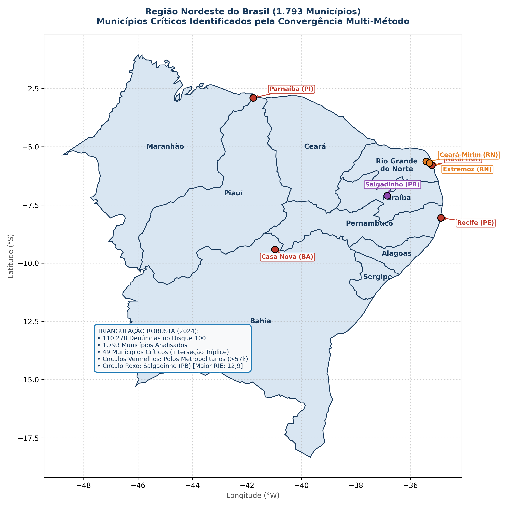
</div>

:::

::: {.column width="58%"}

- **O Território como Determinante Social:**
  - A violência e a violação de direitos humanos não ocorrem de forma homogênea no espaço.
  - Padrões de vulnerabilidade refletem assimetrias históricas, segregação socioespacial e desigualdade no acesso a serviços públicos.

<br/>

- **O Papel Transformador das Geotecnologias:**
  - **Sistemas de Informação Geográfica (SIG):** Integração de bases administrativas e demográficas.
  - **Estatística Espacial:** Transição da simples visualização cartográfica para a inferência estocástica e detecção de aglomerados significativos.
  - **Inteligência Territorial:** Conversão de 110.278 denúncias em insumo acionável para alocação prioritária de redes de acolhimento.

:::

::::

---

##
<h2 style="color:#1a3a5c;">Estrutura da Apresentação</h2>
<hr style="border-color:#2980b9;"/>

:::: {.columns}

::: {.column width="48%"}

1. **Introdução e Contextualização**
   - Cenário nacional da violência e marco legal
   - O serviço Disque 100 (Disque Direitos Humanos)
   - O território nordestino e seus paradoxos
2. **Arcabouço Metodológico e Teórico**
   - Razão de Incidência Espacial (RIE)
   - Autocorrelação Espacial: Moran Global e LISA
   - Estimador Bayesiano Empírico Local (EBEL)
   - Varredura Scan Espacial de Kulldorff
3. **Perfil das Denúncias no Nordeste (2024)**
   - Temporalidade (horários e dias da semana)
   - Perfis de denunciantes, vítimas e suspeitos
   - O domicílio como epicentro da violação

:::

::: {.column width="48%"}

4. **Resultados Espaciais e Detecção de Conglomerados**
   - Diagnóstico de dependência espacial global
   - Aglomerados Alto-Alto no litoral vs. ausência de aglomerados no oeste
   - O caso emblemático de Salgadinho (PB)
   - Convergência dos métodos (49 municípios críticos)
   - Os 6 municípios de grande porte
5. **Geotecnologias, Políticas Públicas e Tomada de Decisão**
   - Cobertura institucional e subnotificação
   - Diretrizes para alocação de equipamentos sociais
   - Trabalhos futuros e considerações finais

:::

::::

---

##
<h2 style="color:#1a3a5c;">Panorama da Violência no Brasil</h2>
<h4>A <span style="color:#c0392b;">URGÊNCIA</span> do Tema</h4>
<hr style="border-color:#2980b9;"/>

:::: {.columns}

::: {.column width="55%"}

- Em 1996, a Assembleia Mundial da Saúde (Resolução WHA49.25) declarou a **violência como um dos principais problemas de saúde pública do mundo**.
- A OMS define violência como o uso intencional da força física ou do poder, real ou em ameaça, que resulte em lesão, morte, dano psicológico ou privação.

<br/>

- **Indicadores Críticos no Brasil (18º Anuário FBSP, 2024):**
  - **46.328** Mortes Violentas Intencionais (MVI) em 2023.
  - Taxa nacional de **22,8 MVI por 100 mil habitantes**.
  - Crescimento de todos os tipos de violência contra as mulheres.
  - Taxa de **41,4 estupros por 100 mil habitantes**.

:::

::: {.column width="43%"}

<div class="danger-box">
<h4 style="color:#c0392b; margin-top:0;">Cenário de Insegurança</h4>
<p style="font-size:18px; line-height:1.4;">
Essas formas de violência violam os direitos humanos de milhares de pessoas e impõem um cenário persistente de insegurança à população brasileira.
</p>
</div>

<div class="metric-card" style="margin-top:15px; border-top-color:#c0392b;">
<div class="metric-val" style="color:#c0392b;">46.328</div>
<div class="metric-lbl">Mortes Violentas Intencionais no Brasil em 2023</div>
</div>

<div class="metric-card" style="margin-top:10px; border-top-color:#f39c12;">
<div class="metric-val" style="color:#f39c12;">41,4 / 100k</div>
<div class="metric-lbl">Taxa de Estupros no Brasil (2023)</div>
</div>

:::

::::

---

##
<h2 style="color:#1a3a5c;">Direitos Humanos</h2>
<h4>Marcos Legais e Garantias</h4>
<hr style="border-color:#2980b9;"/>
<br/>

:::: {.columns}

::: {.column width="50%"}

#### Declaração Universal (1948)
- Resolução 217 A (III) da Assembleia Geral da ONU.
- Estabelece **30 artigos** universais e inalienáveis, consagrando o direito à vida, integridade, liberdade e igualdade de tratamento perante a lei.

#### Constituição Cidadã de 1988
- Eleva a **dignidade da pessoa humana** a fundamento da República Federativa do Brasil (Art. 1º, III).
- Garante inviolabilidade do direito à vida, liberdade, igualdade, segurança e propriedade (Art. 5º).

:::

::: {.column width="48%"}

#### Código Penal e Legislação Correlata
- Decreto-Lei nº 2.848/1940 e leis protetivas específicas:
  - Estatuto da Criança e do Adolescente (ECA — Lei 8.069/1990)
  - Estatuto da Pessoa Idosa (Lei 10.741/2003)
  - Lei Maria da Penha (Lei 11.340/2006)
  - Lei Brasileira de Inclusão da Pessoa com Deficiência (Lei 13.146/2015)

<div class="highlight-box" style="margin-top:15px;">
<strong>O Desafio:</strong> Como conectar as previsões normativas à realidade concreta dos territórios? <em>A resposta passa pela vigilância geoespacial e canais de denúncia ágeis.</em>
</div>

:::

::::

---

##
<h2 style="color:#1a3a5c;">O Serviço Disque 100</h2>
<h4>(Disque Direitos Humanos)</h4>
<hr style="border-color:#2980b9;"/>

:::: {.columns}

::: {.column width="55%"}

- Criado pelo **Ministério dos Direitos Humanos e da Cidadania (MDHC)**, o Disque 100 é um serviço público estratégico e gratuito voltado para o acolhimento de denúncias de violações de direitos fundamentais.

- **Principais Diretrizes Operacionais:**
  - **Disponibilidade Integral:** Opera 24 horas por dia, 7 dias por semana, inclusive feriados.
  - **Acesso Gratuito e Universal:** Ligação gratuita de qualquer telefone fixo ou móvel.
  - **Possibilidade de Anonimato:** A denúncia pode ser feita de forma anônima.
  - **Alcance Internacional:** Atendimento estendido a brasileiros no exterior em mais de 50 países (EUA, Portugal, Espanha, Itália, etc.).

:::

::: {.column width="43%"}

<div class="result-box">
<h4 style="color:#27ae60; margin-top:0;">Encaminhamento Rápido</h4>
<p style="font-size:18px; line-height:1.4;">
Após triagem e qualificação técnica, as denúncias são despachadas aos órgãos da rede de proteção em <strong>até 24 horas</strong>.
</p>
</div>

<div class="highlight-box" style="margin-top:15px;">
<strong style="color:#1a3a5c;">Múltiplos Canais de Entrada:</strong>
<ul style="font-size:18px; margin-top:5px; margin-bottom:0;">
<li>Chamada Telefônica (100)</li>
<li>WhatsApp Oficial do MDHC</li>
<li>Aplicativo Direitos Humanos Brasil</li>
<li>Portal Web gov.br/mdh</li>
</ul>
</div>

:::

::::

---

##
<h2 style="color:#1a3a5c;">O Fluxo Institucional da Denúncia</h2>
<hr style="border-color:#2980b9;"/>
<br/>

| 1. Recepção | 2. Triagem e Qualificação | 3. Georreferenciamento | 4. Despacho (até 24h) | 5. Atuação Local |
|:---:|:---:|:---:|:---:|:---:|
| **Cidadão**<br>Telefone 100, App, Web ou WhatsApp | **Operador MDHC**<br>Identificação da suposta violação, vítima e agressor | **Localização**<br>Atribuição do município do fato e dados contextuais | **Rede de Defesa**<br>Envio automatizado aos órgãos competentes | **Acolhimento e Justiça**<br>Conselho Tutelar, Delegacias, MP, Defensoria |


<br/>


:::: {.columns}

::: {.column width="50%"}
<div class="highlight-box">
<strong>Ponto Crítico:</strong> O fluxo institucional depende da capacidade de resposta local de cada município. Municípios sem Conselhos Tutelares estruturados ou sem delegacias especializadas acumulam passivos graves.
</div>
:::

::: {.column width="48%"}
<div class="warning-box">
<strong>Visão Geotecnológica:</strong> Conhecer o tempo e o destino da denúncia permite mapear a eficiência territorial da rede de proteção social.
</div>
:::

::::

-----

##
<h2 style="color:#1a3a5c;">A Região Nordeste</h2>
<h4>O Território em Análise</h4>
<hr style="border-color:#2980b9;"/>

:::: {.columns}

::: {.column width="50%"}

- **Configuração Geográfica:**
  - 9 Unidades Federativas: AL, BA, CE, MA, PB, PE, PI, RN e SE.
  - Total de **1.793 municípios**.
  - População estimada em 2024 pelo IBGE (SIDRA): mais de **57 milhões de habitantes**.


- **Heterogeneidade Intrarregional:**
  - Faixa Litorânea e Zonas da Mata: Alta densidade demográfica, pólos industriais e turísticos, conurbações metropolitanas complexas.
  - Agreste e Sertão Semiárido: Baixa densidade, dependência agropecuária, maiores distâncias geográficas até serviços de alta complexidade.

:::

::: {.column width="40%"}

<div style="text-align:center;">

</div>

:::

::::

---

##
<h2 style="color:#1a3a5c;">O Paradoxo Nordestino</h2>
<hr style="border-color:#2980b9;"/>
<br/>

<div class="warning-box">
<strong>Dinamismo Econômico vs. Vulnerabilidade Estrutural:</strong> O Nordeste associa expressivo crescimento econômico e desenvolvimento social nas últimas décadas a indicadores críticos de violência (FBSP, 2024).
</div>

<br/>


:::: {.columns}

::: {.column width="48%"}

<div class="metric-card" style="border-top-color:#c0392b;">
<div class="metric-val" style="color:#c0392b;">2 de 3 Estados</div>
<div class="metric-lbl">com maiores taxas de MVI do Brasil (Bahia e Pernambuco)</div>
</div>

<p style="font-size:19px; margin-top:10px;">
Segundo o Anuário de Segurança Pública 2024, a dinâmica do crime organizado e disputas de facções no Nordeste intensificaram as taxas de letalidade violenta.
</p>

:::

::: {.column width="48%"}

<div class="metric-card" style="border-top-color:#e67e22;">
<div class="metric-val" style="color:#e67e22;">7 de 10 Municípios</div>
<div class="metric-lbl">mais violentos do Brasil pertencem ao Nordeste (6 na BA, 1 no CE)</div>
</div>

<p style="font-size:19px; margin-top:10px;">
Esse panorama torna a análise espacial das denúncias ao Disque 100 na região um <strong>campo de análise relevante e urgente</strong> para o planejamento governamental.
</p>

:::

::::

---

##
<h2 style="color:#1a3a5c;">Por que a Abordagem Espacial</h2>
<h4>é Indispensável?</h4>
<hr style="border-color:#2980b9;"/>

<br/>

:::: {.columns}

::: {.column width="50%"}

#### Limitações dos Modelos Aespaciais
- **Agregação Tradicional:** Tabelas simples mascaram heterogeneidades locais extremas.
- **Falácia Ecológica:** Inferir que indivíduos em uma macrorregião possuem o mesmo risco médio de denúncias.
- **Ignorar a Primeira Lei da Geografia (Tobler, 1970):**

  > *"Todas as coisas estão relacionadas com todas as outras, mas coisas próximas estão mais relacionadas do que coisas distantes."*

:::

::: {.column width="48%"}

#### Benefícios da Estatística Espacial
- **Detecção de Dependência Espacial:** Verificar se o número de denúncias de um município depende do comportamento de seus vizinhos.
- **Identificação de Hotspots Estatísticos:** Diferenciar aglomerados reais de flutuações aleatórias.
- **Estabilização de Pequenas Áreas:** Evitar falsos alarmes em municípios com populações diminutas.
- **Territorialização de Recursos:** Alocar conselheiros tutelares, viaturas e centros de acolhimento onde a demanda é comprovadamente crítica.

:::

::::

---

##
<h2 style="color:#1a3a5c;">Base de Dados e Critérios Metodológicos</h2>
<hr style="border-color:#2980b9;"/>

<br/>

:::: {.columns}

::: {.column width="52%"}

- **Fonte de Denúncias:**
  - Dados Abertos do Governo Federal / MDHC (2024).
  - Recorte temporal: **01 de janeiro a 31 de dezembro de 2024**.
  - Total no Nordeste: **110.278 registros de denúncias**.
  - Metadados: data/hora, canal, denunciante, características de vítimas e suspeitos, natureza da violação e município do fato.


- **Fonte Populacional:**
  - Estimativa populacional municipal do IBGE para 2024 (SIDRA).
  - Metodologia baseada na relação de tendência intercensitária.

:::

::: {.column width="46%"}

<div class="highlight-box">
<h4 style="color:#1a3a5c; margin-top:0;">Pressuposto de Independência</h4>
<p style="font-size:18px; line-height:1.4;">
Diante da anonimização estrita e da impossibilidade de identificar renotificações da mesma violação em momentos distintos, todas as denúncias foram tratadas como <strong>eventos estocasticamente independentes</strong> agrupados no nível municipal.
</p>
</div>

<div class="result-box" style="margin-top:12px;">
<strong>Ambiente Computacional:</strong> Software <code>R</code> (R Core Team, 2025) com os pacotes espaciais <code>sf</code>, <code>spdep</code>, <code>SpatialEpi</code> e <code>tmap</code>.
</div>

:::

::::

---

##
<h2 style="color:#1a3a5c;">Perguntas Centrais da Investigação</h2>
<hr style="border-color:#2980b9;"/>

<div class="contrib">

1. **Existe dependência espacial significativa?**
   - As denúncias de violações de direitos humanos no Nordeste formam aglomerados territoriais ou sua distribuição decorre puramente do acaso espacial?

<p/>

2. **Como neutralizar a instabilidade das pequenas áreas?**
   - Como garantir que municípios de 2.000 a 5.000 habitantes com 2 ou 3 denúncias não apresentem taxas inflacionadas espúrias?

<p/>

3. **Onde residem os verdadeiros conglomerados estatísticos?**
   - O método de varredura Scan de Kulldorff confirma os mesmos clusters sugeridos pelos índices locais de autocorrelação (LISA)?

<p/>

4. **Existe convergência multi-método para subsidiar políticas públicas?**
   - Quais municípios nordestinos são qualificados simultaneamente como prioritários por critérios empíricos, bayesianos e de varredura espacial?

</div>

---

##
<h2 style="color:#1a3a5c;">Fluxograma da Abordagem</h2>
<h4>Metodológica Integrada</h4>
<hr style="border-color:#2980b9;"/>

<div style="text-align:center;">
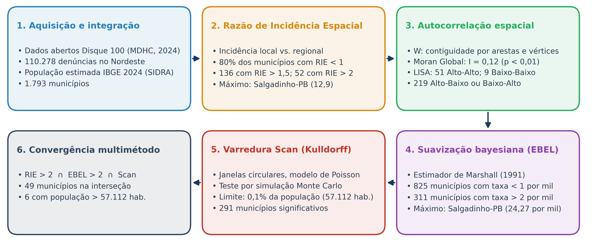
</div>

<div style="font-size:17px; text-align:center; color:#555; margin-top:5px;">
Esteira analítica sequencial: integração do dado bruto ao diagnóstico de convergência territorial multi-método.
</div>

---

##
<h2 style="color:#1a3a5c;">O Desafio de Pequenas Áreas</h2>
<h4>(Small Area Problem)</h4>
<hr style="border-color:#2980b9;"/>

:::: {.columns}

::: {.column width="48%"}

- Considere a taxa bruta local em uma sub-região $i$:
  $$r_i = \frac{y_i}{n_i}$$
  onde $y_i$ é o número de denúncias e $n_i$ é a população.

- A variância da taxa bruta sob o modelo de Poisson é inversamente proporcional à população:
  $$\mathrm{Var}(r_i) = \frac{\lambda_i}{n_i}$$

- **Consequência:**
  - Em municípios com $n_i$ muito pequeno (ex.: 2.500 hab.), uma única denúncia adicional provoca grandes oscilações na taxa calculada.
  - Gera picos espúrios no mapa (variabilidade amostral).

:::

::: {.column width="50%"}

<div style="text-align:center;">
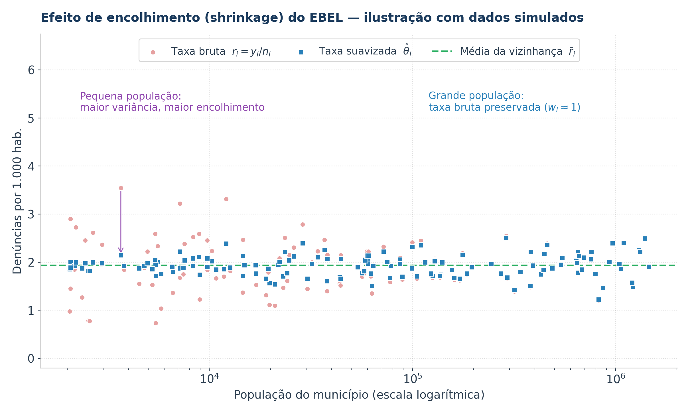
</div>

<div class="info-box" style="margin-top:6px; font-size:16px;">
O <strong>Estimador Bayesiano Empírico Local</strong> opera um efeito de <em>shrinkage</em> (encolhimento), estabilizando as taxas de pequenas áreas em direção à média local.
</div>

:::

::::

---

##
<h2 style="color:#1a3a5c;">Razão de Incidência Espacial (RIE)</h2>
<hr style="border-color:#2980b9;"/>

A **Razão de Incidência Espacial (RIE)** é uma medida padronizada de risco relativo empírico que compara a incidência local observada na sub-região $i$ com a incidência global da macrorregião:

<br/>

$$
\text{RIE}_i = \frac{\text{Incidência Local no Município } i}{\text{Incidência Global na Região Nordeste}} = \frac{y_i / n_i}{\displaystyle \frac{\sum_{k=1}^m y_k}{\sum_{k=1}^m n_k}}
$$

<br/>

onde:

- $y_i$ é o número de denúncias observadas no município $i$ em 2024
- $n_i$ é a população estimada do município $i$ em 2024
- $m = 1.793$ é o número total de municípios da Região Nordeste
- $\sum_{k=1}^m y_k = 110.278$ é o somatório total de denúncias no Nordeste
- $\sum_{k=1}^m n_k$ é a população total acumulada da Região Nordeste

---

##
<h2 style="color:#1a3a5c;">Interpretação Cartográfica da RIE</h2>
<hr style="border-color:#2980b9;"/>

:::: {.columns}

::: {.column width="60%"}

| Faixa da RIE | Interpretação | Implicação Analítica |
| :---: | :--- | :--- |
| **$\text{RIE}_i = 0$** | Nenhuma denúncia no período | Investigar subnotificação |
| **$0 < \text{RIE}_i < 1$** | Inferior à incidência regional | Abaixo da referência |
| **$\text{RIE}_i = 1$** | Igual à incidência regional | Referência |
| **$\text{RIE}_i > 1,5$** | Incidência ao menos 50% superior à regional | Sinal de excesso de incidência |
| **$\text{RIE}_i > 2,0$** | **Incidência superior ao dobro da regional** | **Prioridade de investigação** |

:::

::: {.column width="38%"}

<div class="highlight-box">
<h4 style="color:#1a3a5c; margin-top:0;">Vantagem da RIE</h4>
<p style="font-size:18px; line-height:1.4;">
Permite comparar municípios de portes muito distintos — como capitais e cidades do semiárido — em uma mesma escala adimensional de incidência relativa.
</p>
</div>

<div class="warning-box" style="margin-top:12px;">
<strong style="color:#f39c12;">Ressalva:</strong> Por basear-se em taxas brutas, a RIE é sensível a populações pequenas, o que motiva a suavização bayesiana.
</div>

:::

::::

---

##
<h2 style="color:#1a3a5c;">Matriz de Pesos Espaciais ($\mathbf{W}$)</h2>
<hr style="border-color:#2980b9;"/>

Para modelar a dependência espacial entre os $1.793$ municípios, constrói-se uma matriz de vizinhança espacial $\mathbf{W} \in \mathbb{R}^{m \times m}$:

:::: {.columns}

::: {.column width="55%"}

- **Critério de Contiguidade de Primeira Ordem por Arestas e Vértices (*Queen*):**
  - Dois municípios $i$ e $j$ são considerados vizinhos se compartilham qualquer ponto de fronteira comum (arestas ou vértices):
  $$w_{ij} = \begin{cases} 1, & \text{se } i \text{ e } j \text{ compartilham fronteira} \\ 0, & \text{caso contrário (ou } i = j) \end{cases}$$

- **Padronização por Linha:**
  - Assegura que o somatório dos pesos de cada município seja unitário ($\sum_j w_{ij}^* = 1$):
  $$w_{ij}^* = \frac{w_{ij}}{\sum_{k=1}^m w_{ik}}$$
  - O produto $\mathbf{W}^*\mathbf{z}$ representa a **defasagem espacial** (*spatial lag*), isto é, a média ponderada dos vizinhos.

:::

::: {.column width="43%"}

<div class="result-box">
<h4 style="color:#27ae60; margin-top:0;">Arestas e vértices vs. apenas arestas</h4>
<p style="font-size:18px; line-height:1.4;">
O critério por arestas e vértices (<em>Queen</em>) considera vizinhos também os municípios que compartilham apenas um vértice, enquanto o critério somente por arestas (<em>Rook</em>) os exclui. Em malhas municipais irregulares, o primeiro reduz o número de áreas sem vizinhos e é amplamente adotado em análises de dados de área.
</p>
</div>

:::

::::

---

##
<h2 style="color:#1a3a5c;">Índice I de Moran Global</h2>
<hr style="border-color:#2980b9;"/>

O **Índice I de Moran Global** (Moran, 1950) mede o grau de autocorrelação espacial global de uma variável contínua ou de contagem na malha territorial:

<br/>

$$
I = \frac{m}{\sum_{i=1}^m \sum_{j=1}^m w_{ij}} \frac{\sum_{i=1}^m \sum_{j=1}^m w_{ij} (x_i - \bar{x})(x_j - \bar{x})}{\sum_{i=1}^m (x_i - \bar{x})^2}
$$

<br/>

onde:

- $m$ é o número total de municípios analisados ($m = 1.793$)
- $x_i$ e $x_j$ são os valores observados (número de denúncias) nos municípios $i$ e $j$
- $\bar{x} = \frac{1}{m}\sum_{i=1}^m x_i$ é a média aritmética global
- $w_{ij}$ é o elemento da matriz de conectividade espacial $\mathbf{W}$
- $(x_i - \bar{x})(x_j - \bar{x})$ é o produto cruzado dos desvios em relação à média

---

##
<h2 style="color:#1a3a5c;">Teste de Hipóteses e</h2>
<h4>Inferência do Moran Global</h4>
<hr style="border-color:#2980b9;"/>

:::: {.columns}

::: {.column width="50%"}

#### Teste de Aleatoriedade Espacial
- **Hipótese Nula ($H_0$):** Distribuição espacialmente aleatória das denúncias. Ausência de dependência espacial.
- **Hipótese Alternativa ($H_1$):** Presença de autocorrelação espacial estruturada.

#### Propriedades Estatísticas sob $H_0$
- O valor esperado sob $H_0$ é dado por:
  $$E[I] = -\frac{1}{m - 1} \approx -\frac{1}{1792} \approx -0,000558$$

- A estatística de teste padronizada ($z$-score) é:
  $$Z_I = \frac{I - E[I]}{\sqrt{\mathrm{Var}(I)}} \sim \mathcal{N}(0, 1)$$

:::

::: {.column width="48%"}

#### Escala de Interpretação
- **$I > E[I]$ ($Z_I > 0$ e $p < 0,05$):**
  - **Autocorrelação Espacial Positiva:** Municípios com altos números de denúncias vizinham municípios também altos, e baixos vizinham baixos. Aglomeração (clustering).
- **$I \approx E[I]$ ($p \ge 0,05$):**
  - **Aleatoriedade Espacial:** Ausência de estrutura espacial (independência entre vizinhos).
- **$I < E[I]$ ($Z_I < 0$ e $p < 0,05$):**
  - **Autocorrelação Espacial Negativa:** Padrão alternado entre vizinhos (valores dissimilares adjacentes).

:::

::::

---

##
<h2 style="color:#1a3a5c;">Índice de Moran Local (LISA)</h2>
<hr style="border-color:#2980b9;"/>

Proposto por Anselin (1995), o **LISA** (*Local Indicators of Spatial Association*) decompõe o índice global para identificar a contribuição individual de cada município na formação de clusters espaciais:

<br/>

$$
I_i = \frac{z_i - \bar{z}}{s^2} \sum_{j=1}^m w_{ij} (z_j - \bar{z})
$$

<br/>


:::: {.columns}

::: {.column width="50%"}

- $z_i$ e $z_j$ são as variáveis padronizadas nos municípios $i$ e $j$
- $s^2 = \frac{1}{m}\sum_i (z_i - \bar{z})^2$ é a variância amostral
- A soma de todos os índices locais é proporcional ao Moran Global:
  $$\sum_{i=1}^m I_i = m \cdot I$$

:::

::: {.column width="48%"}

<div class="result-box">
<h4 style="color:#27ae60; margin-top:0;">Propriedades Fundamentais</h4>
<ul style="font-size:17px; margin-bottom:0;">
<li>Permite testar a significância estatística local via pseudo-p-valores obtidos por permutações condicionais de Monte Carlo (ex.: 999 permutações).</li>
<li>Gera o <strong>Moran Scatterplot</strong> e o <strong>Mapa de Clusters LISA</strong>.</li>
</ul>
</div>

:::

::::

---

##
<h2 style="color:#1a3a5c;">O Diagrama de Dispersão de Moran</h2>
<h4>Moran Scatterplot</h4>
<hr style="border-color:#2980b9;"/>

:::: {.columns}

::: {.column width="50%"}

<div style="text-align:center;">
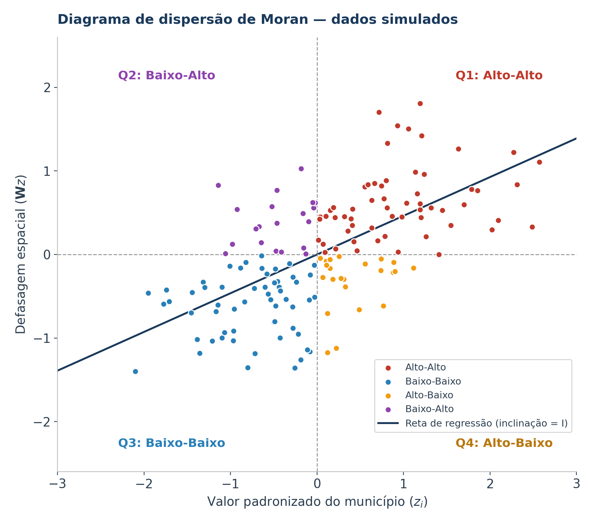
</div>

:::

::: {.column width="48%"}


- **Q1 — Alto-Alto (Hotspots):**
  - Municípios com alta incidência rodeados por vizinhos também com alta incidência. Focos de intervenção prioritária.
- **Q3 — Baixo-Baixo (Coldspots):**
  - Municípios de baixa incidência cercados por vizinhos de baixa incidência.
- **Q2 — Baixo-Alto (Outlier Espacial):**
  - Município de baixa incidência cercado por vizinhos de alta incidência (possível ilha de subnotificação).
- **Q4 — Alto-Baixo (Outlier Espacial):**
  - Polo isolado de alta incidência em meio a vizinhos de baixa incidência.

:::

::::

---

##
<h2 style="color:#1a3a5c;">Estimador Bayesiano Empírico Local</h2>
<h4>EBEL</h4>
<hr style="border-color:#2980b9;"/>

:::: {.columns}

::: {.column width="55%"}

- Baseado na formulação de **Marshall (1991)**, o estimador assume que a verdadeira taxa de ocorrência $\theta_i$ em cada município é uma variável latente não observada.
- As contagens observadas $y_i$ condicionais a $\theta_i$ seguem uma distribuição de **Poisson**:
  $$y_i \mid \theta_i \sim \text{Poisson}(n_i \theta_i)$$
  onde $n_i$ é a população em risco.


- A média e a variância a priori de $\theta_i$ são estimadas pelo método dos momentos na vizinhança espacial de $i$, resultando em uma média ponderada entre a taxa local e a taxa da vizinhança.

:::

::: {.column width="43%"}

<div class="highlight-box">
<h4 style="color:#1a3a5c; margin-top:0;">Intuição Bayesiana</h4>
<p style="font-size:18px; line-height:1.4;">
Se a população $n_i$ é grande, a estimativa permanece próxima da taxa observada $r_i$. Se $n_i$ é pequena, a estimativa incorpora informação da vizinhança (<em>borrowing strength</em>), sendo encolhida em direção à média local.
</p>
</div>

<div class="result-box" style="margin-top:12px;">
Reduz a instabilidade das taxas e os falsos positivos associados a populações pequenas.
</div>

:::

::::

---

##
<h2 style="color:#1a3a5c;">Dedução Matemática do Estimador EBEL</h2>
<hr style="border-color:#2980b9;"/>

O estimador da taxa suavizada para o município $i$, denotado por $\hat{\theta}_i$, é dado pela combinação convexa:

<br/>

$$
\hat{\theta}_i = w_i r_i + (1 - w_i) \bar{r}_i
$$

<br/>

onde o fator de ponderação (*shrinkage factor*) $w_i \in [0, 1]$ é expresso por:

$$
w_i = \frac{s_i^2}{s_i^2 + \frac{\bar{r}_i}{n_i}}
$$


e os parâmetros da distribuição local da vizinhança $V_i$ (incluindo o próprio município $i$) são:

$$
\bar{r}_i = \frac{\sum_{j \in V_i} y_j}{\sum_{j \in V_i} n_j}, \qquad s_i^2 = \frac{\sum_{j \in V_i} n_j (r_j - \bar{r}_i)^2}{\sum_{j \in V_i} n_j} - \frac{\bar{r}_i}{\bar{n}_i}
$$

com $r_j = y_j / n_j$ a taxa bruta no município $j$ e $\bar{n}_i$ a população média dos municípios de $V_i$.

---

##
<h2 style="color:#1a3a5c;">Varredura Scan Espacial de Kulldorff</h2>
<hr style="border-color:#2980b9;"/>

:::: {.columns}

::: {.column width="50%"}

- Desenvolvido por **Kulldorff & Nagarwalla (1995)**, o método de varredura espacial testa se eventos pontuais ou de área apresentam agrupamentos anômalos.


- **Mecanismo das Janelas Circulares:**
  - Posiciona-se um círculo centrado no centróide geográfico de cada município.
  - O raio da circunferência cresce de forma contínua e gradual, englobando centróides adjacentes.
  - A expansão é contida por um limiar máximo predefinido da população sob risco da região (adotado **0,1% da população total do Nordeste**, equivalente a **57.112 pessoas**).

:::

::: {.column width="48%"}

<div style="text-align:center;">
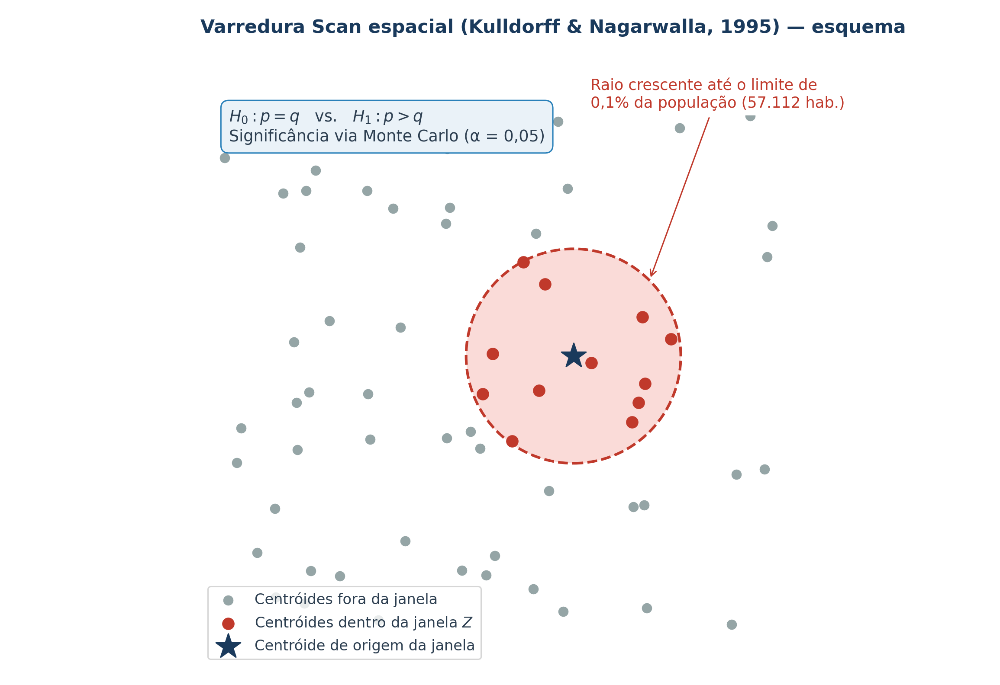
</div>

:::

::::

---

##
<h2 style="color:#1a3a5c;">Função de Verossimilhança e</h2>
<h4>Simulação de Monte Carlo</h4>
<hr style="border-color:#2980b9;"/>

Sob a hipótese nula $H_0$, o risco de uma denúncia é constante em todo o Nordeste ($p = q$). Sob $H_1$, o risco dentro da janela circular $Z$ é superior ao risco externo ($p > q$).

A **Razão de Verossimilhança (LRR)** sob o modelo Poisson é calculada para cada círculo candidato $Z$:

<br/>

$$
\mathrm{LRR}(Z) = \left( \frac{c_Z}{E[c_Z]} \right)^{c_Z} \left( \frac{C - c_Z}{C - E[c_Z]} \right)^{C - c_Z} \cdot \mathbb{I}(c_Z > E[c_Z])
$$

<br/>


onde:

- $C$ é o total de denúncias no Nordeste ($110.278$) e $c_Z$ é o total de denúncias observadas dentro da janela $Z$
- $E[c_Z] = N_Z \cdot (C / N)$ é o número esperado de denúncias sob $H_0$, proporcional à população $N_Z$
- O círculo que maximiza $\mathrm{LRR}(Z)$ é o **Cluster Mais Provável** (*Most Likely Cluster*)
- A significância estatística ($p$-valor) é obtida via **Simulação de Monte Carlo** sob $H_0$, adotando $\alpha = 0,05$

---

##
<h2 style="color:#1a3a5c;">Resultados Descritivos</h2>
<h4>Panorama das 110.278 Denúncias</h4>
<hr style="border-color:#2980b9;"/>

<div class="contrib">
<table style="width:100%; font-size:18px;">
<thead>
<tr>
<th>Dimensão Analisada</th>
<th>Categoria Predominante</th>
<th>Percentual / Valor</th>
<th>Implicação Geotecnológica e Social</th>
</tr>
</thead>
<tbody>
<tr>
<td><strong>Volume Geral</strong></td>
<td>Total de Denúncias no Nordeste (2024)</td>
<td><strong>110.278 registros</strong></td>
<td>Média de ~61,5 denúncias por município</td>
</tr>
<tr>
<td><strong>Denunciante</strong></td>
<td>Terceiros (vizinhos, familiares, agentes)</td>
<td><strong>85,22%</strong></td>
<td>Própria vítima: 14,64% das denúncias</td>
</tr>
<tr>
<td><strong>Canal de Acesso</strong></td>
<td>Ligação Telefônica Convencional</td>
<td><strong>90,86%</strong></td>
<td>WhatsApp: 8,20%; outros canais: 0,94%</td>
</tr>
<tr>
<td><strong>Pico Diário</strong></td>
<td>Horário Comercial (Pico às 10h da manhã)</td>
<td><strong>08h às 18h</strong></td>
<td>Menor volume registrado às 05h da manhã</td>
</tr>
<tr>
<td><strong>Dinâmica Semanal</strong></td>
<td>Dias Úteis (Segunda a Sexta-feira)</td>
<td><strong>80,5%</strong></td>
<td>Redução no sábado (10,7%) e no domingo (8,8%)</td>
</tr>
<tr>
<td><strong>Vítimas Menores</strong></td>
<td>0 a 17 anos (bebês, crianças e adolescentes)</td>
<td><strong>46,74%</strong></td>
<td>Soma das faixas até 2, 3–11 e 12–17 anos</td>
</tr>
<tr>
<td><strong>Vítimas Idosas</strong></td>
<td>60 a 90+ anos de idade</td>
<td><strong>33,81%</strong></td>
<td>Faixa etária individual mais frequente</td>
</tr>
<tr>
<td><strong>Local do Fato</strong></td>
<td>Casa onde reside a vítima (com ou sem o suspeito)</td>
<td><strong>79,33%</strong></td>
<td>48,90% na casa da vítima e do suspeito</td>
</tr>
<tr>
<td><strong>Tipo de Violação</strong></td>
<td>Violação contra a Integridade Física</td>
<td><strong>36,57%</strong></td>
<td>Seguida da Integridade Psíquica (33,48%)</td>
</tr>
</tbody>
</table>
</div>

---

##
<h2 style="color:#1a3a5c;">Dinâmica Temporal</h2>
<h4>A Rotina das Notificações</h4>
<hr style="border-color:#2980b9;"/>

:::: {.columns}

::: {.column width="60%"}
<br/>
<br/>
<br/>

<div style="text-align:center;">
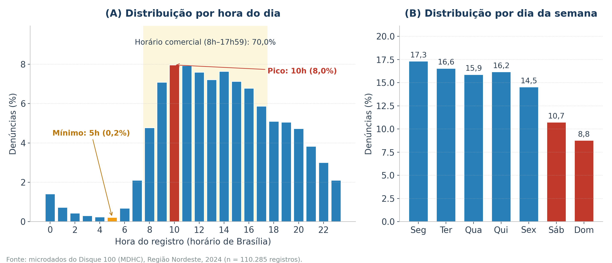
</div>

:::

::: {.column width="38%"}


- **Padrão Circadiano (Painel A):**
  - Pico às **10h** (8,0%) e segundo pico às **14h**.
  - **70,0%** dos registros ocorrem entre **8h e 17h59**.
  - Menor volume às **5h** (0,2%), com queda no fim da noite e na madrugada.


- **Efeito Fim de Semana (Painel B):**
  - Dias úteis: entre 14,5% e 17,3% ao dia.
  - Sábado (10,7%) e domingo (8,8%) apresentam redução.
  - *Hipótese:* a menor oferta de serviços da rede de proteção no fim de semana pode reduzir os encaminhamentos.

:::

::::

---

##
<h2 style="color:#1a3a5c;">Perfil dos Atores</h2>
<h4>Denunciantes e Canais</h4>
<hr style="border-color:#2980b9;"/>

:::: {.columns}

::: {.column width="55%"}

<div style="text-align:center;">
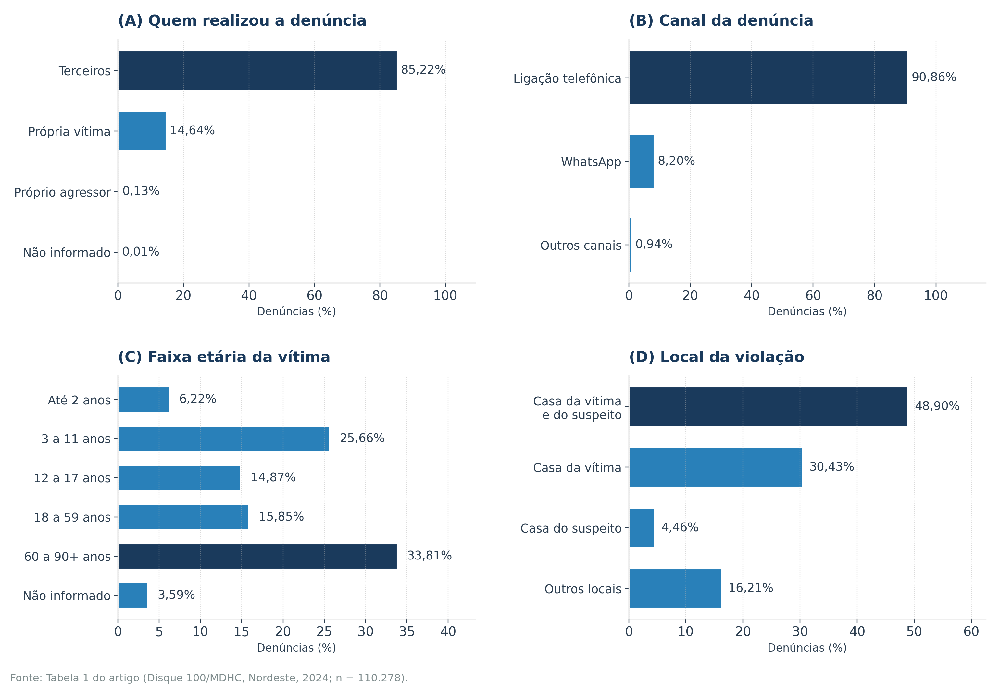
</div>

:::

::: {.column width="43%"}


- **85,22% feitas por Terceiros:**
  - Evidencia o papel da rede comunitária, de profissionais e de vizinhos na notificação.
  - A própria vítima denunciou em 14,64% dos casos.


- **90,86% via Telefonia:**
  - WhatsApp respondeu por 8,20% e os demais canais por 0,94%.
  - A ligação gratuita permanece como principal canal de acesso.

:::

::::

---

##
<h2 style="color:#1a3a5c;">Perfil das Vítimas</h2>
<h4>Distribuição por Faixa Etária</h4>
<hr style="border-color:#2980b9;"/>

<div class="result-box">
<h3 style="color:#27ae60; margin:0 0 5px 0;">80,6% das Vítimas são Crianças/Adolescentes ou Idosos</h3>
A maior parte das denúncias ao Disque 100 envolve indivíduos nos extremos da pirâmide etária; adultos de 18 a 59 anos somam 15,85% e 3,59% não têm a idade informada.
</div>


:::: {.columns}

::: {.column width="48%"}

<div class="metric-card" style="border-top-color:#c0392b;">
<div class="metric-val" style="color:#c0392b;">46,74%</div>
<div class="metric-lbl">Crianças e Adolescentes (0 a 17 anos)</div>
</div>

- Até 2 anos: 6,22%.
- 3 a 11 anos: 25,66%.
- 12 a 17 anos: 14,87%.

:::

::: {.column width="48%"}

<div class="metric-card" style="border-top-color:#e67e22;">
<div class="metric-val" style="color:#e67e22;">33,81%</div>
<div class="metric-lbl">Idosos (60 a 90+ anos de idade)</div>
</div>

- Faixa etária individual mais frequente.
- Contexto de envelhecimento populacional e dependência de cuidados.

:::

::::

---

##
<h2 style="color:#1a3a5c;">Perfil dos Suspeitos</h2>
<h4>Características dos Suspeitos</h4>
<hr style="border-color:#2980b9;"/>

:::: {.columns}

::: {.column width="52%"}

- **Faixa Etária do Agressor:**
  - **59,3%** pertencem à faixa de **18 a 59 anos de idade** (adultos em idade produtiva e de chefia domiciliar).
  - 1,72% de 12 a 17 anos, 6,41% com 60 anos ou mais e 32,62% sem informação.


- **Sexo dos Suspeitos (total de denúncias):**
  - **23,23%** de mulheres apontadas como suspeitas.
  - **19,27%** de homens apontados como suspeitos.
  - Em **57,50%**, o sexo do suspeito não foi informado.
  - *Hipótese:* maior presença feminina nas funções de cuidado no domicílio.

:::

::: {.column width="46%"}

<div class="warning-box">
<h4 style="color:#f39c12; margin-top:0;">O Problema do Dado Faltante</h4>
<p style="font-size:17px; line-height:1.4;">
O fato de <strong>57,50% dos registros de suspeitos e 54,62% de vítimas</strong> não informarem o sexo evidencia limitações no preenchimento administrativo.
</p>
</div>

<div class="highlight-box" style="margin-top:10px;">
<strong>Demanda Geotecnológica:</strong> Necessidade de algoritmos de imputação espacial e padronização digital dos formulários de atendimento.
</div>

:::

::::

---

##
<h2 style="color:#1a3a5c;">Onde a Violência Ocorre?</h2>
<h4>O Domicílio como Local de Ocorrência</h4>
<hr style="border-color:#2980b9;"/>

:::: {.columns}

::: {.column width="50%"}

<div class="metric-card" style="border-top-color:#8e44ad;">
<div class="metric-val" style="color:#8e44ad;">48,90%</div>
<div class="metric-lbl">Residência Compartilhada (Vítima e Suspeito moram juntos)</div>
</div>

<div class="metric-card" style="border-top-color:#2980b9; margin-top:15px;">
<div class="metric-val" style="color:#2980b9;">30,43%</div>
<div class="metric-lbl">Casa da Vítima (suspeito não reside)</div>
</div>

<div class="metric-card" style="border-top-color:#7f8c8d; margin-top:15px;">
<div class="metric-val" style="color:#7f8c8d;">20,67%</div>
<div class="metric-lbl">Casa do Suspeito (4,46%) e Outros Locais (16,21%)</div>
</div>

:::

::: {.column width="48%"}

<div class="danger-box">
<h3 style="color:#c0392b; margin-top:0;">79,33% na Casa da Vítima</h3>
<p style="font-size:19px; line-height:1.5;">
Diferentemente de crimes em vias públicas, as violações denunciadas ocorrem predominantemente no espaço privado, onde o policiamento ostensivo tem alcance limitado.
</p>
</div>

<br/>

<div class="highlight-box">
<strong>Impacto Territorial:</strong> Estratégias baseadas apenas em policiamento ostensivo têm alcance limitado nesse contexto. A prevenção exige agentes comunitários de saúde, assistentes sociais e visitas domiciliares georreferenciadas.
</div>

:::

::::

---

##
<h2 style="color:#1a3a5c;">Natureza das Violações e</h2>
<h4>Distribuição por Estados</h4>
<hr style="border-color:#2980b9;"/>

<br/>

:::: {.columns}

::: {.column width="48%"}

#### Tipologia das Violações
- **Integridade Física:** 36,57%
- **Integridade Psíquica:** 33,48%
- **Negligência:** 17,82%
- **Direitos Sociais:** 3,46%
- **Liberdade Sexual:** 3,30%
- **Integridade Patrimonial:** 2,89%
- **Outras:** 2,48%

:::

::: {.column width="50%"}

#### Liderança por Estados e Cidades
- **Bahia:** Concentra **25,1% das denúncias do Nordeste** (estado mais populoso da região).
- **Fortaleza (CE):** Município que registrou a maior quantidade absoluta de casos em toda a Região Nordeste.
- Pernambuco e Ceará formam, junto com a Bahia, os três grandes eixos de volume absoluto.

<div class="result-box" style="margin-top:15px;">
<strong>Efeito de Escala:</strong> Grandes cidades lideram em contagens absolutas devido ao contingente populacional; a comparação exige taxas relativas.
</div>

:::

::::

---

##
<h2 style="color:#1a3a5c;">Resultados Espaciais</h2>
<h4>Autocorrelação Global Confirmada</h4>
<hr style="border-color:#2980b9;"/>
<br/>

<div class="result-box">
<h3 style="color:#27ae60; margin:0 0 5px 0;">Índice I de Moran Global = 0,12 ($p < 0,01$)</h3>
Rejeição da hipótese nula de aleatoriedade espacial ao nível de 1% de significância.
</div>


:::: {.columns}

::: {.column width="48%"}

#### O que significa $I = 0,12$?
- Confirma a existência de **autocorrelação espacial positiva estatisticamente significativa**.
- Municípios com elevado volume de denúncias não são eventos isolados: tendem a estar cercados por vizinhos que também apresentam elevadas denúncias.
- A magnitude ($I = 0,12$) indica autocorrelação positiva de **intensidade fraca**, porém significativa.

:::

::: {.column width="48%"}

#### Validação Metodológica
- O valor esperado sob independência espacial seria $E[I] = -1/1792 \approx -0,00056$.
- O $p$-valor inferior a 0,01 indica que é improvável que tal agrupamento decorra apenas do acaso.
- Justifica a análise de decomposição local (LISA).

:::

::::

---

##
<h2 style="color:#1a3a5c;">Mapeamento dos Clusters Locais LISA</h2>
<hr style="border-color:#2980b9;"/>

:::: {.columns}

::: {.column width="52%"}

<div style="text-align:center;">
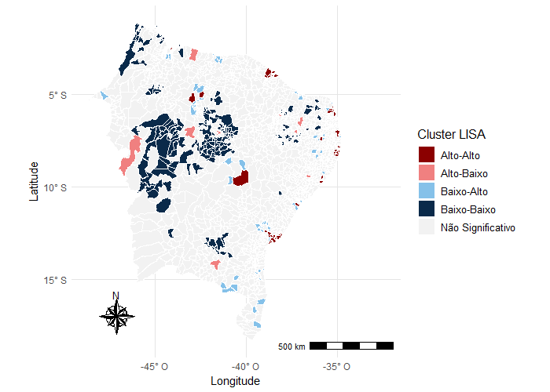
</div>

:::

::: {.column width="46%"}

<br/>

<div class="contrib">
<h4 style="color:#1a3a5c; margin-top:0;">Tipologia dos Clusters LISA</h4>

- **51 Municípios Alto-Alto (Hotspots):**
  - Parte deles localizada mais próxima ao litoral.
- **9 Municípios Baixo-Baixo (Coldspots):**
  - Localizados mais próximos ao oeste e noroeste da região.
- **219 Municípios Outliers Espaciais:**
  - Alto-Baixo ou Baixo-Alto (zonas de contraste e ruptura territorial).
</div>

:::

::::

---

##
<h2 style="color:#1a3a5c;">A Geografia dos Clusters LISA</h2>
<h4>Litoral vs. Interior Ocidental</h4>
<hr style="border-color:#2980b9;"/>


:::: {.columns}

::: {.column width="50%"}

#### O Corredor Litorâneo (Hotspots Alto-Alto)
- **Localização:** Parte dos municípios do cluster Alto-Alto situa-se mais próxima ao litoral.
- **Hipóteses explicativas (não testadas no estudo):**
  - Maior penetração de campanhas informativas.
  - Maior cobertura de telecomunicações.
  - Maior presença de órgãos da rede de proteção.

:::

::: {.column width="48%"}

#### Os Coldspots do Oeste (Baixo-Baixo)
- Apenas 9 municípios no cluster Baixo-Baixo, situados mais próximos ao oeste e noroeste da região.
- **O Dilema da Subnotificação:**
  - Menor ocorrência de violações ou **subnotificação**?
  - Possíveis barreiras de acesso aos canais e receio de exposição em comunidades pequenas.

:::

::::


<div class="highlight-box">
<strong>Conclusão do LISA:</strong> O mapa do Moran Local pode refletir tanto a ocorrência das violações quanto a propensão local à notificação.
</div>

---

##
<h2 style="color:#1a3a5c;">Razão de Incidência Espacial no Nordeste</h2>
<hr style="border-color:#2980b9;"/>

:::: {.columns}

::: {.column width="50%"}

#### Distribuição Empírica da RIE
- **80% dos municípios:** Apresentaram $\text{RIE} < 1$ (incidência local abaixo da média regional).
- **136 municípios:** Apresentaram **$\text{RIE} > 1,5$** (incidência ao menos 50% superior à regional).
- **52 municípios:** Apresentaram **$\text{RIE} > 2,0$** (incidência superior ao dobro da regional).


#### Espacialização
- Há maior quantidade de municípios com $\text{RIE} > 1,5$ mais próximos ao litoral.
- Maior valor: Salgadinho (PB), $\text{RIE} = 12,9$.

:::

::: {.column width="48%"}

<div style="text-align:center;">
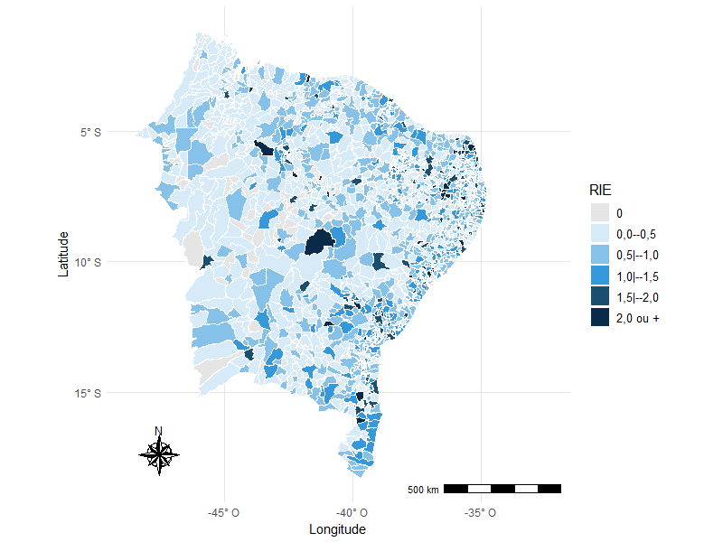
</div>

:::

::::

---

##
<h2 style="color:#1a3a5c;">O Caso Extremo de Salgadinho (PB)</h2>
<h4>Análise de um Valor Extremo</h4>
<hr style="border-color:#2980b9;"/>

:::: {.columns}

::: {.column width="50%"}

- **Os Dados de Salgadinho - PB:**
  - População estimada IBGE 2024: **3.437 habitantes** (85 denúncias).
  - **Maior RIE do Nordeste: 12,9**.
  - **Maior taxa suavizada: 24,27 por mil hab.**


- **Como Interpretar este Valor?**
  - RIE = 12,9 significa quase **13 vezes mais denúncias por habitante** do que a média da Região Nordeste.
  - Em população pequena, poucas dezenas de denúncias produzem taxa muito elevada.

:::

::: {.column width="48%"}

<div class="warning-box">
<h4 style="color:#f39c12; margin-top:0;">Questão Interpretativa</h4>
<p style="font-size:18px; line-height:1.4;">
O valor reflete maior ocorrência de violações ou maior propensão local à notificação (p. ex., registros concentrados por um mesmo órgão)? Os dados agregados não permitem distinguir.
</p>
</div>

<div class="result-box" style="margin-top:15px;">
<strong style="color:#27ae60;">O Papel do Estimador Bayesiano:</strong>
<p style="font-size:17px; margin-top:4px;">
Mesmo após a suavização bayesiana empírica local, Salgadinho manteve a maior taxa do Nordeste (24,27 por mil hab.), indicando que o valor elevado não é explicado apenas pela instabilidade de pequena área.
</p>
</div>

:::

::::

---

##
<h2 style="color:#1a3a5c;">Mapeamento da Taxa Suavizada Bayesiana</h2>
<hr style="border-color:#2980b9;"/>

:::: {.columns}

::: {.column width="52%"}

<div style="text-align:center;">
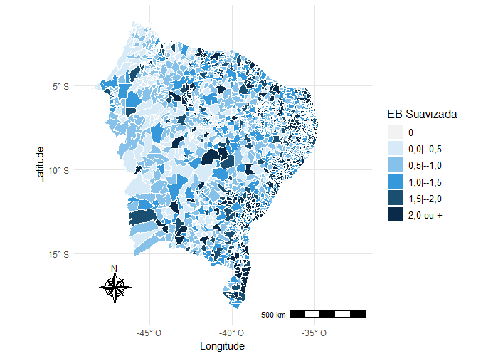
</div>

:::

::: {.column width="46%"}

<br/>

- **825 Municípios:** Taxa suavizada inferior a **1 denúncia por 1.000 habitantes**.
- **311 Municípios:** Taxa suavizada superior a **2 denúncias por 1.000 habitantes**.


- **O que a Suavização Evidencia?**
  - Atenua flutuações aleatórias de municípios com pequena população.
  - Observa-se maior concentração de municípios com taxas superiores a 1,5 próximo ao litoral, padrão semelhante ao da RIE.

:::

::::

---

##
<h2 style="color:#1a3a5c;">Comparação</h2>
<h4>RIE Bruta vs. Taxa Suavizada Bayesiana</h4>
<hr style="border-color:#2980b9;"/>

<br/>

<div class="contrib" style="margin-top:15px;">
<table style="width:100%; text-align:center; font-size:18px;">
<thead>
<tr>
<th>Propriedade Metodológica</th>
<th>Razão de Incidência Espacial (RIE)</th>
<th>Taxa Suavizada Bayesiana (EBEL)</th>
</tr>
</thead>
<tbody>
<tr>
<td><strong>Natureza do Cálculo</strong></td>
<td>Razão determinística direta ($r_i / r_{\text{global}}$)</td>
<td>Média a posteriori ponderada ($w_i r_i + (1-w_i)\bar{r}_i$)</td>
</tr>
<tr>
<td><strong>Sensibilidade a Pequenas Populações</strong></td>
<td>Extremamente alta (sensível a ruído amostral)</td>
<td>Controlada via <em>shrinkage</em> da vizinhança</td>
</tr>
<tr>
<td><strong>Incorporação da Geografia</strong></td>
<td>Apenas comparação pontual com o todo</td>
<td>Uso explícito da topologia da vizinhança ($V_i$)</td>
</tr>
<tr>
<td><strong>Municípios em Alerta no Nordeste</strong></td>
<td>52 municípios com RIE $> 2,0$</td>
<td>311 municípios com Taxa $> 2,0$ por mil hab.</td>
</tr>
<tr>
<td><strong>Papel na Gestão Pública</strong></td>
<td>Identificação rápida de picos e anomalias</td>
<td>Estimação mais estável da incidência</td>
</tr>
</tbody>
</table>
</div>

<br/>


<div class="highlight-box">
<strong>Conclusão Comparativa:</strong> A RIE é uma medida empírica sensível a variações locais, enquanto o Estimador Bayesiano atua como um suavizador espacial, conferindo maior estabilidade aos mapas temáticos.
</div>

---

##
<h2 style="color:#1a3a5c;">Varredura Scan de Kulldorff</h2>
<h4>291 Municípios em Clusters</h4>
<hr style="border-color:#2980b9;"/>

:::: {.columns}

::: {.column width="52%"}

<div style="text-align:center;">
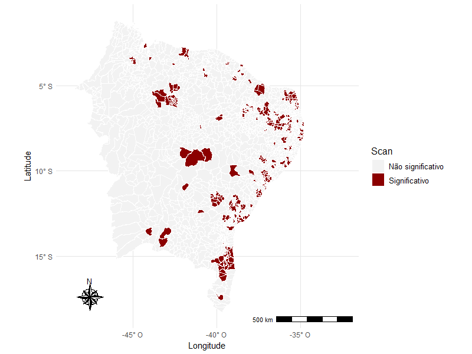
</div>

:::

::: {.column width="46%"}

<br/>

- **291 Municípios Significativos ($p < 0,05$):**
  - Municípios em que a quantidade de denúncias em relação à população é estatisticamente superior ao esperado sob o modelo de Poisson.


- **Configuração Espacial:**
  - Maior concentração de municípios significativos próximo ao litoral.
  - Ausência de municípios significativos no oeste da região.

:::

::::

---

##
<h2 style="color:#1a3a5c;">O Oeste Nordestino: </h2>
<h4>Por que Não Há Clusters no Oeste?</h4>
<hr style="border-color:#2980b9;"/>

<div class="warning-box">
<h3 style="color:#f39c12; margin-top:0;">Ausência de Aglomerados Significativos no Oeste</h3>
<p style="font-size:19px; line-height:1.5;">
Um dos resultados da varredura Scan é a <strong>ausência de municípios significativos no oeste da região</strong>, enquanto os conglomerados concentram-se mais próximos ao litoral.
</p>
</div>


:::: {.columns}

::: {.column width="48%"}

#### Hipótese 1: Baixa Cobertura Institucional
- Ausência de postos físicos do Estado e baixa atuação de conselhos tutelares.
- Populações rurais dispersas sem conectividade estável para ligar ao 100.
- Receio quanto ao anonimato em municípios de pequeno porte.

:::

::: {.column width="48%"}

#### Hipótese 2: Fatores Socioculturais
- Dinâmicas comunitárias tradicionais em que conflitos são mediados intrafamiliarmente.
- O dado reflete **menor propensão à denúncia formal**, e não necessariamente ausência de violência.

:::

::::

---

##
<h2 style="color:#1a3a5c;">Convergência Multi-Método</h2>
<h4>Triangulação Estatística</h4>
<hr style="border-color:#2980b9;"/>

:::: {.columns}

::: {.column width="52%"}

<div style="text-align:center;">
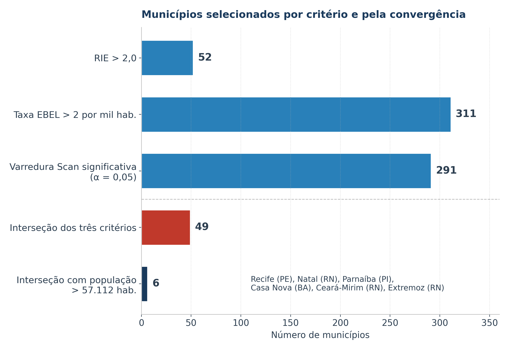
</div>

:::

::: {.column width="46%"}

<br/>

- **Os Três Filtros Estatísticos:**
  1. $\text{RIE} > 2,0$ (52 municípios)
  2. Taxa Bayesiana $> 2,0$ por mil hab. (311 municípios)
  3. Varredura Scan Significativa, $p < 0,05$ (291 municípios)

<div class="danger-box" style="margin-top:15px;">
<h4 style="color:#c0392b; margin-top:0;">A Interseção Tríplice</h4>
<p style="font-size:18px; line-height:1.4;">
<strong>49 municípios</strong> satisfazem simultaneamente os três critérios: RIE &gt; 2, taxa suavizada &gt; 2 por mil hab. e significância na varredura Scan.
</p>
</div>

:::

::::

---

##
<h2 style="color:#1a3a5c;">Os 6 Municípios de Grande Porte</h2>
<hr style="border-color:#2980b9;"/>

<br/>

Dentre os 49 municípios da interseção tríplice, **6 possuem população superior a 57.112 habitantes** (limiar populacional de 0,1% da varredura Scan):


:::: {.columns}

::: {.column width="50%"}

<div class="contrib">
<ol style="font-size:20px; line-height:1.6; margin-bottom:0;">
<li><strong>Recife (PE)</strong> — Capital de Pernambuco</li>
<li><strong>Natal (RN)</strong> — Capital do Rio Grande do Norte</li>
<li><strong>Parnaíba (PI)</strong> — Segundo maior município do Piauí</li>
<li><strong>Casa Nova (BA)</strong> — Submédio São Francisco</li>
<li><strong>Ceará-Mirim (RN)</strong> — Região Metropolitana de Natal</li>
<li><strong>Extremoz (RN)</strong> — Região Metropolitana de Natal</li>
</ol>
</div>

:::

::: {.column width="48%"}

<div class="result-box">
<h4 style="color:#27ae60; margin-top:0;">Independência de Vizinhos</h4>
<p style="font-size:18px; line-height:1.4;">
Como cada um possui população superior ao limite da janela (0,1% da população), esses 6 municípios <strong>não tiveram influência de seus vizinhos</strong> para serem considerados significativos na varredura Scan.
</p>
</div>

<div class="highlight-box" style="margin-top:15px;">
<strong>Destaque para o RN:</strong> 3 dos 6 municípios situam-se no Rio Grande do Norte (Natal, Ceará-Mirim e Extremoz), todos na Região Metropolitana de Natal.
</div>

:::

::::

<!-- 
---

##
<h2 style="color:#1a3a5c;">Diálogo com a Literatura da Escola Nordestina</h2>
<hr style="border-color:#2980b9;"/>

A metodologia deste estudo dialoga com uma sólida tradição científica desenvolvida por pesquisadores nordestinos na modelagem de fenômenos sociais e epidemiológicos:

<br/>

:::: {.columns}

::: {.column width="48%"}

### A Escola da Paraíba (UFPB / UFPE)
- **Moraes, Lucena, Ferreira, Freire, Freitas:**
  - Aplicação pioneira de métodos espaciais para criminalidade letal e saúde coletiva na Paraíba desde a década de 2010.
  - Uso sistemático de modelos Besag-Newell, Scan de Kulldorff e suavização bayesiana para tomada de decisão em gestão territorial.

:::

::: {.column width="48%"}

### Evolução Metodológica
- A análise atual do Disque 100 em escala regional (1.793 municípios) representa uma **expansão de escala sem precedentes**:
  - Da escala municipal (bairros de João Pessoa) para a escala macrorregional nordestina.
  - Da violência física letal (homicídios) para o espectro integral das violações de direitos humanos.

:::

::::

---

##
<h2 style="color:#1a3a5c;">Paralelo Epidemiológico: Dengue e Tuberculose na PB</h2>
<hr style="border-color:#2980b9;"/>

:::: {.columns}

::: {.column width="50%"}

### Dengue na Paraíba (2001–2010)
- *Ferreira, Gomes, Freire & Moraes (2012)* e *Freitas, Ferreira & Moraes (2012)*:
  - Demonstraram que arboviroses seguem eixos rodoviários e adensamentos urbanos.
  - A autocorrelação espacial positiva é induzida por fatores ambientais e mobilidade populacional.
  - **Paralelo com o Disque 100:** A conectividade e a infraestrutura viária atuam como vetores de transmissão de informação e conscientização cidadã.

:::

::: {.column width="48%"}

### Tuberculose na Paraíba (2008–2010)
- *Freire, Ferreira & Moraes (2012)* e *Ferreira, Freire & Moraes (2012)*:
  - Detecção de clusters via método **Besag e Newell**.
  - Evidenciaram que aglomerados de tuberculose concentram-se em bolsões de vulnerabilidade socioeconômica e habitações precárias.
  - **Conexão:** O mesmo ambiente domiciliar precarizado que facilita a transmissão da TB abriga violações de direitos humanos de crianças e idosos.

:::

::::

---

##
<h2 style="color:#1a3a5c;">Dinâmica Espacial de Homicídios na Paraíba</h2>
<hr style="border-color:#2980b9;"/>

:::: {.columns}

::: {.column width="50%"}

### Homicídios por Arma Branca e Fogo
- *Lucena (2010)* e *Lucena & Moraes (2012)*:
  - Investigaram padrões espaço-temporais de homicídios em João Pessoa (2001 a 2009).
  - Arma de fogo associada à disputa de territórios de drogas na periferia urbana.
  - Arma branca predominantemente associada a conflitos interpessoais e violência doméstica.

. . .

- *Freitas & Moraes (2012)* e *Oliveira et al. (2019)*:
  - Confirmaram forte autocorrelação espacial local em homicídios intencionais na capital paraibana.

:::

::: {.column width="48%"}

<div class="highlight-box">
<h4 style="color:#1a3a5c; margin-top:0;">Diferenciação Fundamental</h4>
<p style="font-size:18px; line-height:1.4;">
Enquanto os homicídios por arma de fogo geram <em>hotspots</em> em áreas periféricas abertas, as denúncias do Disque 100 penetram no espaço intradomiciliar, revelando violências silenciosas que não chegam às certidões de óbito do IML.
</p>
</div>

<div class="result-box" style="margin-top:15px;">
O Disque 100 atua na <strong>fase pré-letal</strong> da violência!
</div>

:::

::::

---

##
<h2 style="color:#1a3a5c;">Estudos Recentes: COVID-19 e População LGBTQIA+</h2>
<hr style="border-color:#2980b9;"/>

:::: {.columns}

::: {.column width="50%"}

### COVID-19 na Paraíba (Pontes, 2023)
- Análise espacial e espaço-temporal da difusão pandêmica.
- Demonstrou o fluxo centrífugo da doença: do litoral (João Pessoa e Campina Grande) em direção aos municípios do Sertão.
- Reforça a importância do monitoramento de difusão em tempo real.

. . .

### Violência contra LGBTQIA+ (Neivas & Baptista, 2022)
- Aplicação de Estimador Bayesiano e Moran para analisar agressões contra a comunidade LGBTQIA+ no Brasil.
- Constatou que o medo da estigmatização gera subnotificação severa fora das grandes capitais cosmopolitas.

:::

::: {.column width="48%"}

<div class="contrib">
<h4 style="color:#1a3a5c; margin-top:0;">Convergência Temática</h4>
<p style="font-size:18px; line-height:1.4;">
Esses estudos validam o arcabouço metodológico adotado neste trabalho e comprovam que a <strong>estatística espacial bayesiana e inferencial</strong> é a ferramenta padrão-ouro para investigar populações vulnerabilizadas no território brasileiro.
</p>
</div>

:::

::::

---

##
<h2 style="color:#1a3a5c;">Síntese Metodológica Comparada</h2>
<hr style="border-color:#2980b9;"/>

<div class="contrib" style="margin-top:20px;">
<table style="width:100%; text-align:center; font-size:18px;">
<thead>
<tr>
<th>Método Estatístico</th>
<th>Hipótese Testada / Foco</th>
<th>Formato do Cluster</th>
<th>Principal Vantagem</th>
<th>Principal Limitação</th>
</tr>
</thead>
<tbody>
<tr>
<td><strong>LISA (Moran Local)</strong></td>
<td>Autocorrelação espacial linear local</td>
<td>Dependente da malha poligonal ($W$)</td>
<td>Identifica outliers espaciais (Baixo-Alto e Alto-Baixo)</td>
<td>Sensível ao tamanho das áreas em contiguidade</td>
</tr>
<tr>
<td><strong>Besag & Newell</strong></td>
<td>Excesso de casos em vizinhança de tamanho $k$</td>
<td>Conjunto de $k$ centróides mais próximos</td>
<td>Excelente para detecção de clusters pequenos e raros</td>
<td>Requer escolha subjetiva do parâmetro $k$</td>
</tr>
<tr>
<td><strong>Varredura Scan (Kulldorff)</strong></td>
<td>Razão de Verossimilhança sob modelo de Poisson</td>
<td>Círculos com raio contínuo variável</td>
<td>Sem viés de pré-seleção; teste inferencial Monte Carlo</td>
<td>Dificuldade para capturar clusters lineares/alongados</td>
</tr>
<tr>
<td><strong>Estimador Bayesiano (EBEL)</strong></td>
<td>Estabilização de taxas em pequenas áreas</td>
<td>Suavização contínua por vizinhança local</td>
<td>Elimina ruídos em municípios de baixa população</td>
<td>Não fornece teste formal de hipóteses ($p$-valor)</td>
</tr>
</tbody>
</table>
</div>

<br/>

. . .

<div class="result-box">
<strong>A Força da Nossa Abordagem:</strong> Nenhum método foi utilizado isoladamente. A convergência multi-método supera as limitações individuais de cada técnica.
</div>

--- -->

##
<h2 style="color:#1a3a5c;">Geotecnologias na Prática</h2>
<h4>Da Tabela ao SIG Decisório</h4>
<hr style="border-color:#2980b9;"/>

:::: {.columns}

::: {.column width="60%"}

#### A Realidade dos Dados Públicos Tradicionais
- Planilhas CSV ou Excel com milhões de linhas.
- Análises resumidas a rankings estaduais ou médias macroeconômicas.
- Inviabilidade de visualização por equipes técnicas de assistência social e segurança pública.


#### A Abordagem via Geotecnologias
- **Geocodificação e Padronização:** Conversão de metadados em camadas vetoriais geográficas.
- **Interoperabilidade:** Cruzamento dinâmico de dados de denúncias com camadas de infraestrutura social (CRAS, CREAS, escolas, postos de saúde).
- **Painéis Interativos (WebGIS / Dashboards):** Alertas territoriais automáticos para gestores municipais e estaduais.

:::

::: {.column width="38%"}

<div style="text-align:center;">

</div>

<div class="info-box" style="margin-top:10px; font-size:16px;">
O dado ganha vida quando associado às coordenadas geográficas da malha territorial.
</div>

:::

::::

---

##
<h2 style="color:#1a3a5c;">Cobertura Institucional</h2>
<h4>e o Dilema da Subnotificação</h4>
<hr style="border-color:#2980b9;"/>

:::: {.columns}

::: {.column width="52%"}

- Em 80% dos municípios nordestinos, a RIE foi menor que 1,0, e em centenas de cidades do sertão as denúncias foram nulas ou residuais.


- **Interpretação de Taxas Nulas:**
  - Município com zero denúncias no Disque 100 **não significa** município isento de violações.
  - Pode refletir subnotificação, baixa cobertura institucional ou barreiras de acesso aos canais.


- **A Contribuição do Geoprocessamento:**
  - Identificar sobreposição espacial entre baixas taxas de denúncias e indicadores de infraestrutura de telecomunicações e IDHM.
  - Mapear áreas de **baixa cobertura institucional**, onde o acesso aos canais de denúncia é limitado.

:::

::: {.column width="45%"}

<div class="warning-box">
<h4 style="color:#f39c12; margin-top:0;">Subnotificação e Alocação de Recursos</h4>
<p style="font-size:18px; line-height:1.4;">
Alocar recursos apenas onde há denúncias registradas pode reforçar a baixa cobertura das áreas com subnotificação. O geoprocessamento permite identificar e corrigir esse viés.
</p>
</div>

<div class="highlight-box" style="margin-top:15px;">
<strong>Ação Proativa:</strong> Ações itinerantes de cidadania nos municípios do cluster Baixo-Baixo do oeste da região.
</div>

:::

::::

---

##
<h2 style="color:#1a3a5c;">Alocação de Equipamentos Públicos</h2>
<hr style="border-color:#2980b9;"/>

Com base nos **49 municípios** identificados pela convergência dos métodos, sugerem-se diretrizes de planejamento territorial:

<br/>

:::: {.columns}

::: {.column width="48%"}

#### 1. Conselhos Tutelares e Infância
- Priorizar o fortalecimento de conselhos tutelares nos municípios da interseção (p. ex., Recife, Natal, Ceará-Mirim, Parnaíba).
- Garantir estrutura física, veículos e psicólogos para atendimento emergencial.


#### 2. Delegacias Especializadas
- Implantação de DEAMs (Delegacias da Mulher) e Delegacias de Proteção ao Idoso com funcionamento 24h nas capitais e grandes cidades conurbadas.

:::

::: {.column width="48%"}

#### 3. Fortalecimento da Rede CRAS / CREAS
- Centros de Referência Especializados de Assistência Social capacitados para realizar busca ativa em domicílios com histórico de negligência.


#### 4. Integração de Informações
- Conectar o banco de dados do Disque 100 aos prontuários do SUS (notificações do SINAN) e registros escolares da rede municipal/estadual via identificador espacial unificado.

:::

::::

---

##
<h2 style="color:#1a3a5c;">Arquitetura Computacional</h2>
<h4>e Reprodutibilidade em R</h4>
<hr style="border-color:#2980b9;"/>

:::: {.columns}

::: {.column width="48%"}

```r
# Script Síntese do Pipeline Espacial em R
library(sf)
library(spdep)
library(SpatialEpi)

# 1. Leitura e Integração Espacial
malha_ne <- read_sf("nordeste_municipios.geojson")
dados_d100 <- read.csv("disque100_2024_ne.csv")
dados_pop  <- read.csv("populacao_ibge_2024.csv")

# 2. Matriz de contiguidade (arestas e vértices)
nb_queen <- poly2nb(malha_ne, queen = TRUE)
w_list   <- nb2listw(nb_queen, style = "W", zero.policy = TRUE)

# 3. Autocorrelação Espacial
moran_global <- moran.test(malha_ne$denuncias, w_list)
lisa_local   <- localmoran(malha_ne$denuncias, w_list)

# 4. Suavização Bayesiana Empírica Local
bayes_taxa <- EBlocal(malha_ne$denuncias, malha_ne$populacao, nb_queen)

# 5. Varredura Scan Espacial de Kulldorff
scan_res <- kulldorff(geo = centroides, cases = malha_ne$denuncias,
                      pop = malha_ne$populacao, expected.cases = E,
                      pop.upper.bound = 0.001, n.simulations = 999,
                      alpha.level = 0.05, plot = FALSE)
```

:::

::: {.column width="50%"}

<div class="result-box">
<h4 style="color:#27ae60; margin-top:0;">Open Science e Reprodutibilidade</h4>
<ul style="font-size:17px; line-height:1.4;">
<li>Código 100% desenvolvido em ambiente de código aberto (Software R).</li>
<li>Uso dos pacotes do ecossistema espacial moderno (<code>sf</code> para manipulação vetorial e <code>spdep</code> para econometria e estatística espacial).</li>
<li>Pipeline automatizado: permite atualizar a pesquisa anualmente a cada novo release de dados abertos do MDHC.</li>
</ul>
</div>

<div class="highlight-box" style="margin-top:15px;">
<strong>Interoperabilidade:</strong> Camadas exportáveis em formato GeoJSON, Shapefile e GeoPackage para consumo direto no QGIS ou ArcGIS.
</div>

:::

::::

---

##
<h2 style="color:#1a3a5c;">Limitações Metodológicas do Estudo</h2>
<hr style="border-color:#2980b9;"/>
<br/>

:::: {.columns}

::: {.column width="50%"}

#### 1. Escala Municipal Agregada
- Os dados abertos oficiais do MDHC são anonimizados em nível de município para proteção das vítimas e denunciantes.
- Não é possível, na base pública, analisar variações intra-urbanas em nível de bairro ou setor censitário.

<br/>

#### 2. Pressuposto de Independência
- Possibilidade de duplicidade em que diferentes vizinhos denunciam a mesma violência para o mesmo domicílio.

:::

::: {.column width="48%"}

#### 3. Campos com Preenchimento Ignorado
- Elevada proporção de registros sem informação de sexo da vítima (54,62%) e do suspeito (57,50%).
- Limita análises interseccionais refinadas de gênero e raça.

<br/>

#### 4. Dependência do Meio Físico
- A denúncia via telefone 100 requer acesso a sinal telefônico estável, favorecendo áreas urbanizadas frente a comunidades rurais e ribeirinhas isoladas.

:::

::::

---

##
<h2 style="color:#1a3a5c;">Trabalhos Futuros</h2>
<h4>e Novas Fronteiras Geotecnológicas</h4>
<hr style="border-color:#2980b9;"/>

:::: {.columns}

::: {.column width="50%"}

- **Modelagem Espaço-Temporal:**
  - Aplicação da estatística de varredura espaço-temporal (*Space-Time Scan*) para capturar a formação e dissipação dinâmica de clusters ao longo dos 12 meses do ano.

<br/>

- **Deep Learning e Aprendizado Estatístico de Máquina:**
  - Modelos para dados tabulares (p. ex., **TabNet** e **TabR**) integrando covariáveis socioeconômicas do Censo Demográfico 2022 (saneamento, renda, escolaridade).

:::

::: {.column width="48%"}

- **Análise Espacial Intra-Urbana em Capitais:**
  - Celebração de acordos de cooperação técnica com o MDHC para acesso a dados georreferenciados por endereçamento pontual em capitais (Recife, João Pessoa, Fortaleza e Salvador).

<br/>

<div class="result-box" style="margin-top:20px;">
<h4 style="color:#27ae60; margin-top:0;">Impacto Social Direto</h4>
<p style="font-size:18px; line-height:1.4;">
O objetivo final é criar um <strong>Sistema de Alerta Precoce de Vulnerabilidade Territorial</strong> baseado em IA e Geoprocessamento para as secretarias estaduais de direitos humanos.
</p>
</div>

:::

::::

---

##
<h2 style="color:#1a3a5c;">Síntese dos Principais Resultados</h2>
<hr style="border-color:#2980b9;"/>


| Dimensão | Achado Central da Pesquisa | Significado Estratégico |
|:---|:---|:---|
| **Volume e Padrão** | 110.278 denúncias registradas em 2024 na Região Nordeste | Magnitude crítica da demanda social por proteção de direitos |
| **Vulnerabilidade** | 80,6%: crianças/adolescentes (46,74%) ou idosos (33,81%) | Necessidade de políticas intersetoriais para infância e envelhecimento |
| **Ambiente** | 79,33% das violações ocorrem na casa onde reside a vítima | Exige busca ativa e acompanhamento domiciliar |
| **Autocorrelação** | $I = 0,12$ ($p < 0,01$); 51 municípios Alto-Alto (LISA) | Dependência espacial positiva, com concentração próxima ao litoral |
| **Convergência** | 49 municípios na interseção (RIE > 2, EBEL > 2, Scan significativo) | Territórios prioritários para investimentos públicos |
| **Grande Porte** | 6 municípios com pop. > 57.112 hab. (Recife, Natal, Parnaíba, Casa Nova, Ceará-Mirim e Extremoz) | Significativos sem influência de vizinhos (Scan) |


---


##
<h2 style="color:#1a3a5c;">Conclusões</h2>
<hr style="border-color:#2980b9;"/>
<br/>

:::: {.columns}

::: {.column width="50%"}

1. **A Força da Estatística Espacial:**
   - A combinação da Razão de Incidência Espacial, do Estimador Bayesiano Empírico Local e da Varredura Scan permitiu ir além de rankings de contagens absolutas e caracterizar a distribuição espacial das denúncias.

<br/>

2. **Superação do Viés de Pequenas Áreas:**
   - A suavização bayesiana estabiliza taxas de municípios pequenos; Salgadinho (PB) manteve-se como o maior valor mesmo após a suavização.

:::

::: {.column width="48%"}

3. **Justiça Territorial em Direitos Humanos:**
   - A identificação dos 49 municípios na convergência dos métodos oferece subsídio para o MDHC e as secretarias estaduais priorizarem a alocação de recursos.

<br/>

4. **O Compromisso das Geotecnologias:**
   - A integração de SIG, estatística espacial e dados administrativos abertos contribui para a tomada de decisão e a proteção de populações vulneráveis.

:::

::::

---

##
<h2 style="color:#1a3a5c;">Referências Bibliográficas</h2>
<hr style="border-color:#2980b9;"/>

<div style="font-size:18px; line-height:1.6;">

- **ANSELIN, L.** Local Indicators of Spatial Association—LISA. *Geographical Analysis*, v. 27, n. 2, p. 93-115, 1995.
- **BESAG, J.; NEWELL, J.** The detection of clusters in rare diseases. *Journal of the Royal Statistical Society: Series A (Statistics in Society)*, v. 154, n. 1, p. 143-155, 1991.
- **KULLDORFF, M.; NAGARWALLA, N.** Spatial disease clusters: detection and inference. *Statistics in Medicine*, v. 14, n. 8, p. 799-810, 1995.
- **MARSHALL, R. J.** Mapping disease and mortality rates using empirical Bayes estimators. *Journal of the Royal Statistical Society: Series C (Applied Statistics)*, v. 40, n. 2, p. 283-294, 1991.
- **MORAN, P. A. P.** Notes on continuous stochastic phenomena. *Biometrika*, v. 37, n. 1-2, p. 17-23, 1950.
- **ORGANIZAÇÃO MUNDIAL DA SAÚDE (OMS).** *Violence: a public health priority*. World Health Organization, 1996 (Resolução WHA49.25).
- **ORGANIZAÇÃO DAS NAÇÕES UNIDAS (ONU).** *Declaração Universal dos Direitos Humanos*. Resolução 217 A (III), Paris, 1948.
- **TOBLER, W. R.** A computer movie simulating urban growth in the Detroit region. *Economic Geography*, v. 46, p. 234-240, 1970.
- **FERREIRA, J. A.; GOMES, R. G. S.; FREIRE, D. T. G.; MORAES, R. M.** Análise de padrões espaciais do dengue no estado da Paraíba no período de 2001 à 2010. *Anais do Evento Científico UFPB*, 2012.
- **FERREIRA, J. A.; FREIRE, D. T. G.; MORAES, R. M.** Detecção de conglomerados espaciais de tuberculose no estado da Paraíba utilizando o método Besag e Newell. *Anais UFPB*, 2012.
</div>

---

##
<h2 style="color:#1a3a5c;">Referências Bibliográficas</h2>
<hr style="border-color:#2980b9;"/>

<div style="font-size:18px; line-height:1.5;">

- **FÓRUM BRASILEIRO DE SEGURANÇA PÚBLICA.** *18º Anuário Brasileiro de Segurança Pública*. São Paulo: FBSP, 2024.

- **FREIRE, D. T. G.; FERREIRA, J. A.; MORAES, R. M.** Análise dos casos de tuberculose no estado da Paraíba no período de 2008 a 2010. *Anais UFPB*, 2012.
- **FREITAS, W. W. L.; FERREIRA, J. A.; MORAES, R. M.** Análise do padrão espacial do dengue em 2010 no estado da Paraíba. *PIBIC/UFPB/CNPq*, 2012.
- **FREITAS, W. W. L.; MORAES, R. M.** Análise de Padrões Espaciais e Espaço-Temporal de Homicídios em João Pessoa. *SIMED*, 2012.
- **LUCENA, S. E. F.** *Avaliação de modelos espaço-temporais aplicados aos homicídios por arma branca e arma de fogo em João Pessoa, PB, nos anos de 2001 a 2009*. Monografia (Graduação em Estatística) — UFPB, 2010.
- **LUCENA, S. E. F.; MORAES, R. M.** Detecção de agrupamentos espaço-temporais para identificação de áreas de risco de homicídios por arma branca em João Pessoa, PB. *Boletim de Ciências Geodésicas*, v. 18, n. 4, p. 605-623, 2012.
- **NEIVAS, G. S.; BAPTISTA, A. C.** Análise exploratória de dados espaciais da violência contra LGBTQIA+ no Brasil. *Revista Brasileira de Cartografia*, v. 74, n. 1, p. 159-173, 2022.
- **PONTES, C. F.** Análise Espacial e Espaço-Temporal da COVID-19 no Estado da Paraíba. *Revista Espaço & Geografia*, v. 26, 2023.

</div>

<!-- ---

##
<h2 style="color:#1a3a5c;">Agradecimentos e Apoio Institucional</h2>
<hr style="border-color:#2980b9;"/>
<br/>

<div style="text-align:center;">

</div>

<br/>

:::: {.columns}

::: {.column width="50%"}

- **Instituições de Pesquisa e Ensino:**
  - Universidade Federal de Pernambuco (**UFPE**)
  - Departamento de Estatística (**DE/CCEN/UFPE**)
  - Programa de Pós-Graduação em Estatística (**PPGEst/UFPE**)
  - Universidade Federal da Paraíba (**UFPB**)

:::

::: {.column width="48%"}

- **Apoio e Organização do Evento:**
  - Instituto Federal da Paraíba (**IFPB — Campus João Pessoa**)
  - Comissão Organizadora do **II GEOTEC 2026**
  - Agências de Fomento: **FACEPE**, **CNPq** e **CAPES**
  - Ministério dos Direitos Humanos e da Cidadania (**MDHC**)

:::

::::

--- -->

##  {background-image="images/banner_geotec.jpeg" background-opacity=".12" background-size="cover"}

<br/>
<br/>

<div style="text-align:center;">

</div>


<div style="text-align:center;">
<h1 style="color:#1a3a5c; font-size:40pt; margin-bottom:10px;">Muito Obrigado!</h1>
<!-- <h3 style="color:#2980b9; font-size:24pt; font-weight:500;">Perguntas, Comentários e Discussão</h3> -->
</div>

<br/>
<br/>

<div style="text-align:center;">
<h4 style="color:#1a3a5c; font-size:22pt; margin-bottom:4px;"><strong>Prof. Dr. Jodavid de Araújo Ferreira</strong></h4>
<p style="color:#555; font-size:18pt; margin:0;">Departamento de Estatística — UFPE</p>
<p style="color:#2980b9; font-size:16pt; margin-top:8px;">
📧 <a href="mailto:jodavid.ferreira@ufpe.br">jodavid.ferreira@ufpe.br</a> &nbsp;|&nbsp; 
🌐 <a href="https://jodavid.github.io" target="_blank">jodavid.github.io</a> &nbsp;|&nbsp; 
🐙 <a href="https://github.com/jodavid" target="_blank">github.com/jodavid</a>
</p>
</div>

<br/>

<div style="text-align:center; color:#7f8c8d; font-size:16pt; margin-top:20px;">
<strong>II GEOTEC 2026</strong> — Encontro de Geotecnologias | IFPB Campus João Pessoa
</div>
